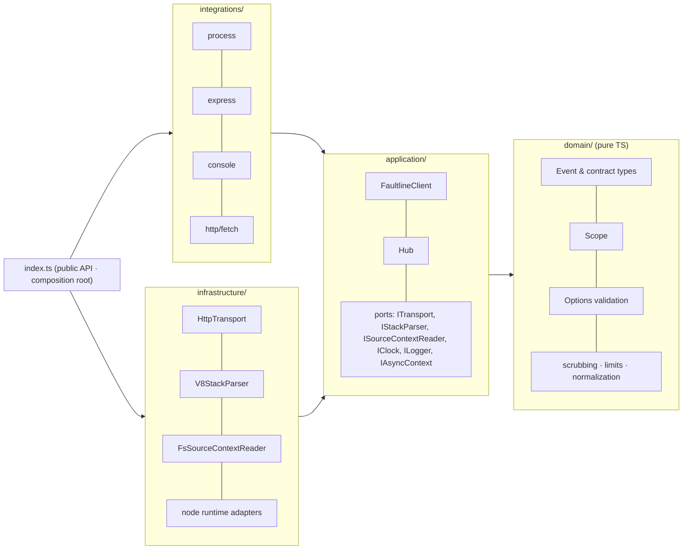
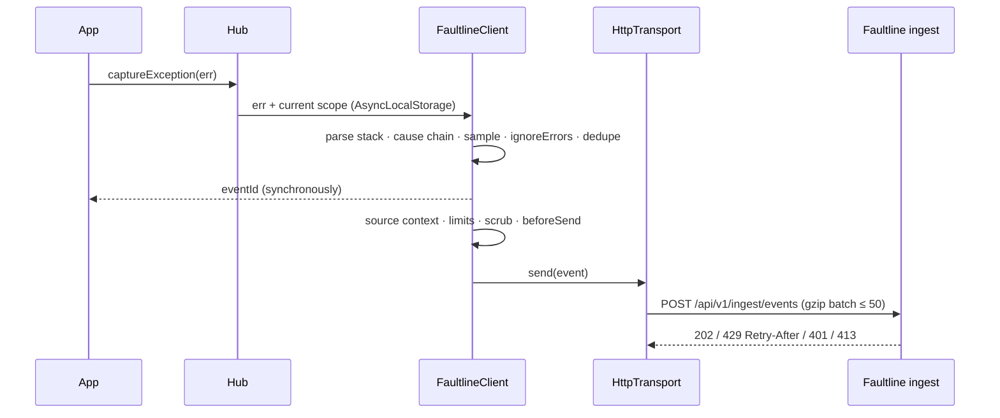

# @faultline/node

The Node.js SDK for [Faultline](https://faultline.dev), a self-hostable error-tracking
platform. It captures exceptions and messages, adds context (stack traces with source,
breadcrumbs, request data, user, tags), scrubs secrets, and sends batched, gzip-compressed
events to the Faultline ingest API.

- **No runtime dependencies.** Uses native `fetch`, `zlib`, `crypto`, `fs` and `AsyncLocalStorage`.
- **Never crashes your app.** Every public function is exception-safe, and internal errors are
  logged only when `debug: true`.
- **Dual ESM + CommonJS** with TypeScript declarations. Runs on Node **≥ 18**.

## Quickstart

```bash
pnpm add @faultline/node     # or npm i @faultline/node / yarn add @faultline/node
```

```ts
import * as Faultline from "@faultline/node"; // or: const Faultline = require("@faultline/node")

Faultline.init({
  apiKey: process.env.FAULTLINE_API_KEY, // flt_ingest_...
  environment: process.env.NODE_ENV,
  release: "api@1.4.2",
});

try {
  doRiskyThing();
} catch (err) {
  Faultline.captureException(err, { tags: { feature: "checkout" } });
}

Faultline.captureMessage("Payment webhook retried", "warning");
```

### Express

```ts
import express from "express";
import * as Faultline from "@faultline/node";

Faultline.init({ apiKey: process.env.FAULTLINE_API_KEY });

const app = express();
app.use(Faultline.Handlers.requestHandler()); // first: per-request scope + request data
// ... your routes
app.use(Faultline.Handlers.errorHandler()); // after routes, before your own error handler
app.use((err, req, res, next) => res.status(500).json({ eventId: res.locals.faultlineEventId }));
```

`requestHandler()` forks a scope per request (AsyncLocalStorage), so `setUser` / `setTag` /
breadcrumbs inside a request never leak into other concurrent requests. `errorHandler()`
captures errors whose status (`status`, `statusCode`, `status_code`, `output.statusCode`) is
≥ 500, or that have no status. It then calls `next(err)` unchanged. Works with Express 4 and 5.

A runnable demo is in [`examples/express-app`](examples/express-app).

## API

| Function                                                                     | Description                                                                                                                      |
| ---------------------------------------------------------------------------- | -------------------------------------------------------------------------------------------------------------------------------- |
| `init(options)`                                                              | Configure the SDK. Calling it again replaces the previous client.                                                                |
| `captureException(err, { tags, extra, user, level, fingerprint, contexts })` | Capture an `Error` or any thrown value. Returns the `eventId`, or `undefined` when the event was dropped or the SDK is disabled. |
| `captureMessage(message, level = "info")`                                    | Capture a message. The second argument may also be a capture context.                                                            |
| `setUser({ id, email, username, ipAddress })` / `setUser(null)`              | Set or clear the user on the current scope.                                                                                      |
| `setTag(key, value)` / `setTags({...})`                                      | Searchable string tags.                                                                                                          |
| `setContext(name, {...})` / `setExtra(key, value)`                           | Structured context or arbitrary extra data.                                                                                      |
| `addBreadcrumb({ type, category, message, level, data })`                    | Manual breadcrumb. `type` is one of `default`, `http`, `log`, `query`, `navigation`.                                             |
| `withScope((scope) => …)`                                                    | Run code with a forked scope. Changes apply only inside the callback, including async work it starts.                            |
| `await flush(timeoutMs = 2000)`                                              | Wait for queued events to be sent. Resolves `false` on timeout and never rejects.                                                |
| `await close(timeoutMs = 2000)`                                              | Flush, remove the integrations, and disable the SDK.                                                                             |
| `Handlers.requestHandler()` / `Handlers.errorHandler({ shouldHandleError })` | Express middleware.                                                                                                              |
| `isEnabled()`                                                                | `true` once `init` has succeeded.                                                                                                |

`setUser`, `setTag`, `setContext`, `setExtra` and `addBreadcrumb` write to the **current**
scope. Outside a request or `withScope` that is the global scope. Inside one, it is the forked
scope.

## Options

| Option           | Type                                  | Default                                                        | Description                                                                                                                                                           |
| ---------------- | ------------------------------------- | -------------------------------------------------------------- | --------------------------------------------------------------------------------------------------------------------------------------------------------------------- |
| `apiKey`         | `string`                              | **required**                                                   | Public ingest key (`flt_ingest_...`). Sent as `X-Faultline-Key`.                                                                                                      |
| `endpoint`       | `string`                              | `https://api.faultline.dev`                                    | Base URL of the Faultline server. Override it when self-hosting.                                                                                                      |
| `environment`    | `string`                              | —                                                              | e.g. `production`, `staging`.                                                                                                                                         |
| `release`        | `string`                              | —                                                              | e.g. `api@1.4.2` or a git sha.                                                                                                                                        |
| `serverName`     | `string`                              | `os.hostname()`                                                | Reported as `serverName`.                                                                                                                                             |
| `sampleRate`     | `number` 0..1                         | `1`                                                            | Fraction of events to send.                                                                                                                                           |
| `maxBreadcrumbs` | `number`                              | `50`                                                           | Breadcrumbs kept per scope (capped at 100).                                                                                                                           |
| `sendDefaultPii` | `boolean`                             | `false`                                                        | When `false`, the user IP and the `cookie`, `set-cookie`, `authorization`, `proxy-authorization`, `x-forwarded-for`, `x-real-ip` and `forwarded` headers are removed. |
| `beforeSend`     | `(event) => event \| null \| Promise` | —                                                              | Modify or drop (`null`) an event. Runs after scrubbing. If it throws, the event is dropped.                                                                           |
| `ignoreErrors`   | `(string \| RegExp)[]`                | `[]`                                                           | Strings match as substrings, RegExps are tested. Both are matched against the exception type, the message, and `"Type: message"`.                                     |
| `integrations`   | `{ process, express, console, http }` | `{ process: true, express: false, console: true, http: true }` | Toggle the built-in integrations (see below).                                                                                                                         |
| `enabled`        | `boolean`                             | `true`                                                         | `false` turns the SDK into a no-op (`apiKey` is then not required).                                                                                                   |
| `debug`          | `boolean`                             | `false`                                                        | Log SDK internals (dropped events, retries, invalid options) to the console.                                                                                          |

Invalid options never throw:

- An invalid optional value falls back to its default.
- A missing `apiKey` or an unusable `endpoint` disables the SDK.
- Run with `debug: true` to see why.

### Integrations

- **process**: captures `uncaughtException` and `unhandledRejection` at level `fatal`, flushes
  for up to 2s, then keeps Node's default behavior: it prints the stack and exits with code 1,
  and it honors `--unhandled-rejections=warn|none|warn-with-error-code|strict`. If your app
  registers its own handlers, the SDK only captures and flushes, and your handler decides
  whether to exit.
- **console**: `console.log/info/warn/error/debug` calls become `log` breadcrumbs. The original
  method is always called.
- **http**: outgoing `http`/`https` requests (`request`, `get`) and `fetch` calls become `http`
  breadcrumbs (method, URL, status). The instrumentation is passive: it does not change
  arguments, return values or stream semantics. The SDK's own ingest requests are never
  recorded.
- **express**: `Handlers.*` always work. The flag is reserved.

## Self-hosting

Set `endpoint` to your server's base URL. The SDK posts to `{endpoint}/api/v1/ingest/events`:

```ts
Faultline.init({ apiKey: "flt_ingest_...", endpoint: "http://localhost:4000" }); // local faultline-server
Faultline.init({ apiKey: "flt_ingest_...", endpoint: "https://faultline.internal.example.com" });
```

## What gets sent

Each event follows the shared Faultline event contract: `eventId` (uuid v4), `timestamp`,
`level`, `platform: "node"`, `exception` (type, value, frames ordered oldest → newest, `cause`
chain), `message`, `tags`, `user`, `request`, `contexts` (`runtime`, `os`, plus your own),
`breadcrumbs`, `extra`, `fingerprint`, `environment`, `release`, `serverName`, and
`sdk: { name: "@faultline/node", version }`.

The SDK enforces the pinned limits before sending:

| Field                         | Limit                                  |
| ----------------------------- | -------------------------------------- |
| Frames                        | 100 (newest kept)                      |
| Breadcrumbs                   | 100                                    |
| Tags                          | 50 (key ≤ 32 chars, value ≤ 200 chars) |
| `message` / `exception.value` | 8192 chars                             |
| Source context                | ±5 lines, each ≤ 300 chars             |
| `exception.cause` chain       | 5 exceptions in total                  |
| Batch                         | ≤ 50 events and ≤ 1 MB                 |

**Scrubbing (client side, same rules as the server):**

- Values under keys matching
  `/(authorization|cookie|set-cookie|password|passwd|secret|token|api[_-]?key|x-faultline-key)/i`
  become `"[Filtered]"`. This applies to request headers and query, `extra`, `contexts`, tags
  and breadcrumb data.
- Credit-card-like strings in request, `extra` and breadcrumb data are also filtered, as are
  sensitive URL query parameters.

**Delivery:**

- Events wait in an in-memory queue. The queue holds at most 100 events and drops the oldest
  when full.
- The queue is flushed every 2s, or as soon as it holds 20 events, in gzip-compressed batches.
  Each request times out after 5s.
- Failed requests are retried with exponential backoff and jitter. A `429` is retried after
  its `Retry-After` delay.
- A `401` or `413` response drops the batch. With `debug: true` the SDK logs the reason.
- All timers are `unref`'d, so the SDK never keeps your process alive. Call
  `await Faultline.flush()` before a deliberate exit, for example in serverless handlers or
  CLI scripts.

## Architecture

The SDK follows Clean Architecture. Dependencies point inward only, and ESLint
(`no-restricted-imports` per layer) enforces this in CI.





See [ARCHITECTURE.md](ARCHITECTURE.md) for the decision log.

## Development

Contributing needs Node ≥ 22 for the dev tooling. The published package itself runs on Node ≥ 18.

| Script           | What it does                                                                                  |
| ---------------- | --------------------------------------------------------------------------------------------- |
| `pnpm install`   | Install dependencies.                                                                         |
| `pnpm lint`      | ESLint (typescript-eslint, strict and type-checked, layer boundaries) plus a Prettier check.  |
| `pnpm typecheck` | `tsc --noEmit` (strict, `noUncheckedIndexedAccess`).                                          |
| `pnpm test`      | Vitest: unit, integration, contract-conformance and a local mock ingest server.               |
| `pnpm build`     | tsup: `dist/index.js` (ESM), `dist/index.cjs` (CJS), `.d.ts` / `.d.cts`.                      |
| `pnpm smoke`     | Smoke-test the built `dist/` through `require` and `import`, plus a real child-process crash. |
| `pnpm changeset` | Describe a change for the next release.                                                       |

The SDK has no environment variables of its own; everything is passed to `init`. The example
app reads `FAULTLINE_API_KEY` and `FAULTLINE_ENDPOINT`.

### Releasing

[Changesets](https://github.com/changesets/changesets) handles versioning:

1. Add a changeset in your PR with `pnpm changeset`.
2. On `main`, `.github/workflows/release.yml` opens a "Version Packages" PR.
3. Merging that PR publishes to npm with provenance. This needs the `NPM_TOKEN` secret.

## License

MIT
